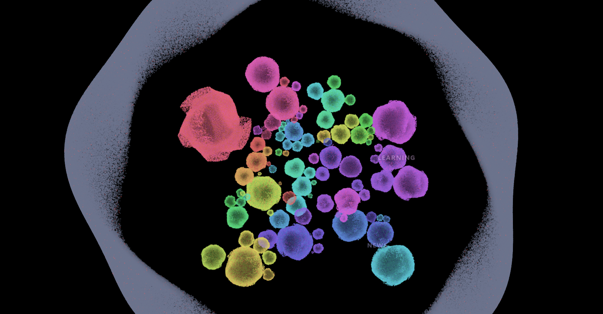

# Celesta

A custom Gecko browser with an OLED star-network start page. Sites are bubbles in a
zero-gravity field: size is popularity, position is relatedness, and clicking one dives
into it.



## What is in here

| Path | Purpose |
| --- | --- |
| `home/` | The start page: WebGL sky, GPU bubble field, warp lock-on, right-click omnibox. Runs standalone over HTTP. |
| `CelestaLauncher.cs` | `Celesta.exe`: seeds the profile prefs and starts the built browser on `chrome://celesta/content/index.html`. |
| `patches/firefox-celesta.patch` | Full diff against `mozilla-firefox/firefox` `main`: branding, newtab redirect, `browser/content/celesta/` chrome, prefs. |
| `installer/` | NSIS script + staging script that trims the runtime and produces `Celesta-Setup-0.1.0.exe`. |
| `sites-radar.backup.js` | Traffic data: Cloudflare Radar rankings plus CrUX origins. |
| `mozconfig` | Build configuration (`--with-branding=browser/branding/celesta`). |
| `docs/home.png` | The screenshot above, captured by `home/capture.mjs`. |

The 1 GB Firefox clone and its 34 GB build output are deliberately not in this repo.

## Start page behaviour

- Hovering a bubble plays that site's own celesta note — a deterministic pitch from a
  four-octave pentatonic, faint, and silent while media is playing.
- The graph ships an 8,000-domain head for an instant start; the full 1.2M-domain
  catalogue loads in the background and powers search and the site count.
- Left click locks on and opens the site, right click opens the site menu, right click on
  empty space opens the omnibox.

## Run the start page

```sh
cd home
python -m http.server 8742
# open http://127.0.0.1:8742/index.html
```

No build step. `sites.js` merges the curated sites with the radar dataset; the layout runs
in a worker and is cached in IndexedDB, so the first load is the slow one.

## Build the browser

```powershell
$env:MOZCONFIG = 'D:\Celesta-Browser\mozconfig'
$env:MOZBUILD_STATE_PATH = 'D:\.mozbuild'
cd D:\Celesta-Browser\gecko
./mach build
./mach run
```

`mach` refuses source paths containing spaces, so the tree must live at a space-free path
(`D:\Celesta-Browser`, not `D:\Celesta Browser`). The spaced folder name can stay as a
junction if you prefer it in Explorer.

## Apply the patch to a fresh clone

```powershell
git clone https://github.com/mozilla-firefox/firefox.git celesta-src
cd celesta-src
git apply --3way <repo>\patches\firefox-celesta.patch
```

Two generated files (`browser/content/celesta/sites-radar.js`, `home/sites-layout.js`) are
excluded from the patch; regenerate them from `sites-radar.backup.js`.

## Notes

- `mach bootstrap` pulls Mozilla's own clang, Rust and Node into `D:\.mozbuild`; the system
  toolchains are not used.
- The first build is the expensive one (~2h40m here). Later builds are incremental.
- `home/capture.mjs` needs a running dev server and Brave; it drives a headless instance
  over the DevTools protocol and writes `docs/home.png`.
