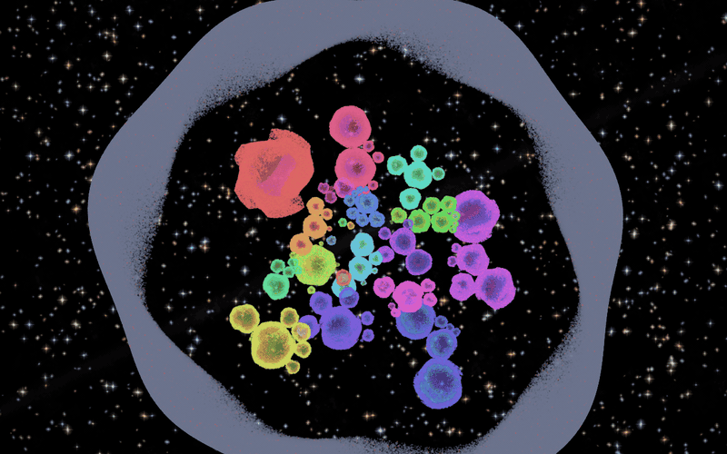

<div align="center">

# Celesta

**A browser whose start page is a galaxy of the web.**

Every site is a glowing bubble in a zero-gravity star field. Size is popularity, position is relatedness, and clicking one dives you into it.

[](https://github.com/d1sc0nnxct/Celesta-Browser/releases/latest)
[](#install)
[-444?style=for-the-badge)](#how-it-is-built)



</div>

---

## Highlights

- **1.2 million sites on one map.** Cloudflare Radar rankings plus CrUX origins, laid out so related sites sit together. Search, hover and click all work at any zoom.
- **A real night sky.** A WebGL nebula and a Hubble-style star field with realistic temperature colours, depth, parallax and astigmatism, on a pure-black OLED background.
- **Smooth at scale.** Bubbles are drawn on the GPU in one pass, labels come from a worker-built text atlas, and the nebula renders off the main thread.
- **It sounds like a celesta.** Every site has its own note, hovering plays it, and diving into a site plays the notes of its six nearest neighbours. A random jingle greets you on load. All of it follows one volume slider and goes quiet while any media is playing.
- **Dive in.** Clicking a bubble zooms the camera through the field into the site. The camera stays inside a bounded box so you can never get lost in empty space.
- **Safe browsing.** Sites flagged for malware or phishing by Cloudflare or the Block List Project stay on the map, but opening one lists every danger first and asks.
- **Private by default.** Telemetry, studies, Pocket and sponsored content are off.
- **Updates itself.** The launcher checks GitHub Releases on every start and offers to install a newer version.

## Install

1. Download `Celesta-Setup-<version>.exe` from the [latest release](https://github.com/d1sc0nnxct/Celesta-Browser/releases/latest).
2. Run it (it asks for administrator rights) and pick an install folder.
3. Start **Celesta** from the Start menu or desktop.

Your profile lives in `%LOCALAPPDATA%\Celesta\profile`, so uninstalling and updating never touch your data.

### Using the start page

| Action | What it does |
| --- | --- |
| Scroll / pinch | Zoom toward the pointer |
| Drag | Pan the view |
| Hover a bubble | Plays the site's note and lights its links |
| Left click | Lock on, dive in and open the site |
| Middle click | Open the site in a new tab |
| Right click a bubble | Site menu |
| Right click empty space | Omnibox: search the whole catalogue |
| `Ctrl` + `Space` | Show the hover bar (it hides itself again) |

## How it is built

Celesta is a patch set on top of Firefox, not a rewrite. The repository keeps only what is ours; the Firefox clone and its ~34 GB build output are not in it.

| Path | Purpose |
| --- | --- |
| `patches/firefox-celesta.patch` | The full diff against Firefox 161: branding, new-tab takeover, the `browser/content/celesta/` start page and chrome, prefs. |
| `home/` | The start page on its own. Runs over plain HTTP with no build step. |
| `CelestaLauncher.cs` | `Celesta.exe`: seeds profile prefs, checks for updates, starts the browser. |
| `installer/` | NSIS script and a staging script that trims the runtime to ship. |
| `sites-radar.backup.js` | The traffic dataset behind the map. |
| `mozconfig` | Build configuration (`--with-branding=browser/branding/celesta`). |
| `docs/` | Screenshots and per-release notes. |

### Build the browser

`mach` refuses source paths with spaces, so keep the tree at a space-free path such as `D:\Celesta-Browser`.

```powershell
git clone https://github.com/mozilla-firefox/firefox.git gecko
cd gecko
git apply --3way ..\patches\firefox-celesta.patch

$env:MOZCONFIG = 'D:\Celesta-Browser\mozconfig'
$env:MOZBUILD_STATE_PATH = 'D:\.mozbuild'
./mach build          # first build is ~2h40m; later ones are incremental
./mach run
```

For JavaScript and CSS changes only, `./mach build faster` takes about two minutes.

Two generated files, `browser/content/celesta/sites-radar.js` and `home/sites-layout.js`, are excluded from the patch. Regenerate them from `sites-radar.backup.js`.

After changing anything in `gecko/`, refresh the patch:

```powershell
cd gecko
git diff HEAD > ..\patches\firefox-celesta.patch
```

### Package a release

```powershell
.\build-launcher.ps1          # compile Celesta.exe
.\installer\stage.ps1         # copy and trim the runtime into installer\Celesta
makensis installer\celesta.nsi
```

Bump `VERSION` in `installer/celesta.nsi` and `FallbackVersion` in `CelestaLauncher.cs` first, then tag `v<version>` and attach the installer to a GitHub release. The launcher's update check reads the latest release's `.exe` asset.

### Run only the start page

```sh
cd home
python -m http.server 8742
# open http://127.0.0.1:8742/index.html
```

The layout runs in a worker and is cached in IndexedDB, so the first load is the slow one.

### Profiling

Set `user_pref("Celesta.profiling", true);` in a profile's `user.js` to write `Celesta-profile.log` next to it: per-shader GPU time, long frames, FPS drops, main-thread hangs and memory.

## Notes

- `mach bootstrap` pulls Mozilla's own clang, Rust and Node into `D:\.mozbuild`; system toolchains are not used.
- Release history is in [`docs/`](docs) and on the [releases page](https://github.com/d1sc0nnxct/Celesta-Browser/releases).

## Licence

Celesta is built on Firefox, which is under the [Mozilla Public License 2.0](https://www.mozilla.org/MPL/2.0/). The repository has no separate licence file for Celesta's own additions yet.
